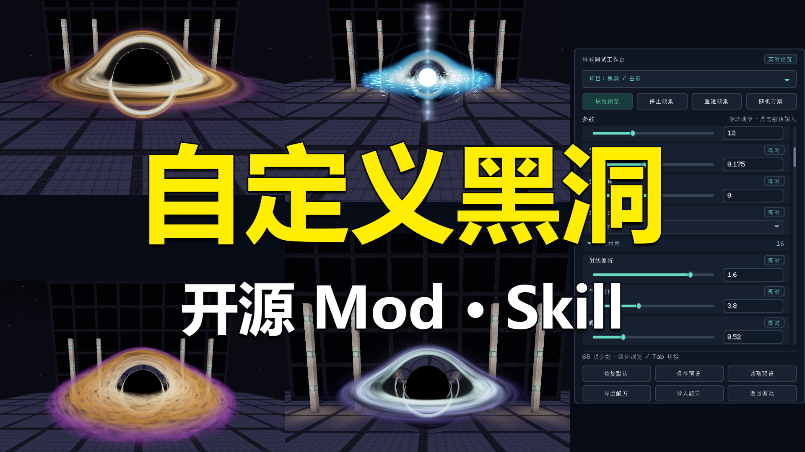
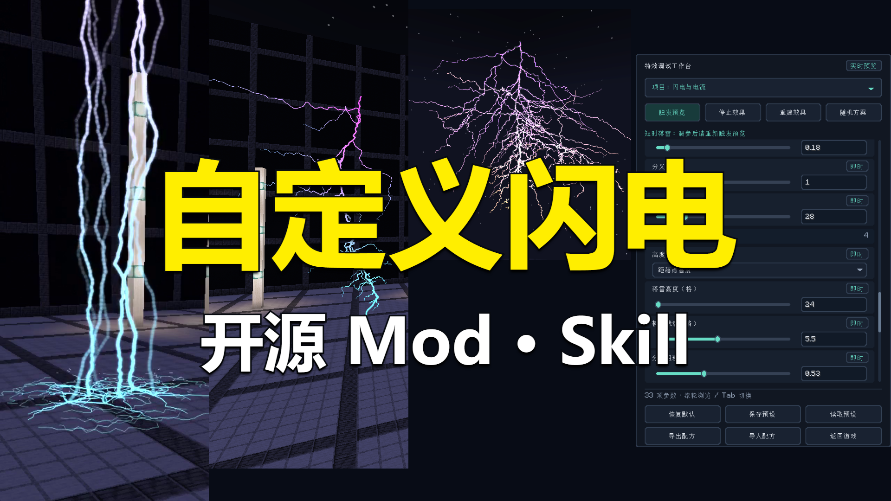

# 视频制作工作流 · Video Production Workflow

用于 Minecraft Mod、Skill 和开源项目介绍的独立制作工具集：真实素材录制、镜头规划、Remotion 中文适配、横竖版剪辑、配音字幕、截图拼接封面和交付检查。

## 快速开始

```powershell
git clone https://github.com/Roxio-sketch/video-production-workflow.git
cd video-production-workflow/templates/remotion-showcase
npm ci
npm run studio:zh
```

按终端显示的地址打开 Studio。模板包含横竖版中文图层，支持时间轴和属性编辑。中文适配锁定 **Remotion 4.0.534**，生成并校验 552 个显示资源文件、3011 处静态替换，使用 1614 条词典条目。版本或官方资源哈希不符时拒绝覆盖。原生错误、外部文档及用户代码不保证完全中文。

- [完整制作方法](docs/workflow.md)
- [中文补丁与恢复](docs/studio-zh.md)
- [封面制作](docs/cover.md)
- [配音、字幕和声音](docs/audio.md)
- [项目内容与复用边界](docs/inventory.md)
- [验证记录](docs/validation.md)
- [许可与来源](docs/provenance.md)

## 四个 Skills

| Skill | 用途 |
|---|---|
| [video-production-workflow](skills/video-production-workflow/SKILL.md) | 总流程、交付标准及工具路由 |
| [remotion-studio-zh](skills/remotion-studio-zh/SKILL.md) | 中文补丁生成、核验、应用和恢复 |
| [mod-skill-video-producer](skills/mod-skill-video-producer/SKILL.md) | 功能覆盖、实际录制、连贯解说和成片检查 |
| [demo-cover-compositor](skills/demo-cover-compositor/SKILL.md) | 真实截图拼接、UI 裁图和封面导出 |

按需把完整 Skill 文件夹复制到 Codex 的 skills 目录。总流程与汉化 Skill 需保留本仓库工具路径；具体方法也可直接阅读文档。

## 封面实例

| 黑洞与白洞 | 闪电与雷劫 |
|---|---|
|  |  |

示例使用实际游戏截图和参数 UI，不用后期生成效果冒充项目能力。模板中的图片与封面 props 可直接复用为布局示例，其他项目替换成自己的素材。

## 目录

`tools/studio-zh`：可配置汉化工具与词典；`templates/remotion-showcase`：可安装运行的基础工程与封面模板；`skills`：制作技能；`examples/shader-showcase`：历史横竖版时间轴、配音脚本与文稿；`examples/minecraft-capture-isolated`：项目专用 framebuffer 录制源码；`records`：原制作与验证记录。

普通模板无需 API key。原始录像、音乐、配音模型和依赖缓存不随仓库分发。历史完整剪辑例依赖未分发媒体，不能当成开箱即用的成片工程。

原创工作流、脚本与模板按 MIT；Remotion 和第三方依赖遵循各自许可证。本项目不是 Remotion 官方中文发行版，也不重新许可 Remotion。[详细范围](docs/provenance.md)。
